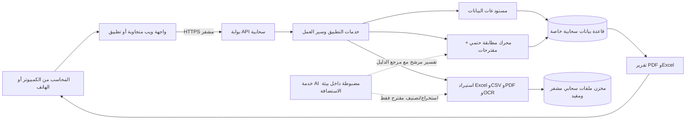

# خطة المنتج ودليل العمارة المقترح

## نظام مطابقة كشوف الموردين

**اسم المشروع:** وفاق الموردين  
**القائد وصاحب المشروع:** رضوان — مشروع فردي

**الحالة:** وثيقة عمل للمراجعة والتصحيح مع صاحب المشروع  
**الإصدار:** 0.1 — 25 نوفمبر 2026  
**حدودها:** تخطيط المنتج وعمارة مقترحة؛ لا تغيّر الشفرة أو قاعدة البيانات أو إعدادات التشغيل.

> هذه الوثيقة امتداد لخطة الاستكشاف والتحليل الموجودة في `docs/stage-0-discovery.md` و`docs/stage-1-analysis.md`، وليست اعتمادًا نهائيًا للميزات أو التقنية. المشكلة تُبنى على تجربة المحاسب والسلوك الملحوظ؛ وجود تنفيذ برمجي سابق في مجلد المشروع لا يُعدّ دليلًا على احتياج السوق ولا سببًا لتوسيع النطاق.

## 1. ملخص القرار

نبني أداة داخلية لمطابقة كشوف الموردين مع سجلات الشركة، تبدأ بمورد واحد وجلسة واحدة قابلة للمراجعة، وتساعد المحاسب على كشف البنود غير المتطابقة وتفسيرها وتجهيز متابعة موثقة. جوهر القيمة هو التعامل مع اختلاف المراجع، والقيود التجميعية، وفروق التوقيت بين التوريد والمخازن والمحاسبة، والخصومات أو الإشعارات الدائنة التي لم يعالجها المورد.

الذكاء الاصطناعي يساعد في قراءة المستندات غير المهيكلة واستخراج إشارات من البيان؛ أما مبالغ المطابقة والتجميع والرصيد والتأكيد فتُحسب بقواعد محاسبية حتمية، ولا يُعتمد اقتراح ملتبس تلقائيًا.

**التسمية المستخدمة في هذه الوثيقة:** «وفاق الموردين».

## 2. المشكلة وسياق الاستخدام

### المشكلة كما وصفها المحاسب

المحاسب يطابق يدويًا ثلاثة كشوف لمورد خلال نحو ثلاث ساعات، وفي كل كشف قرابة 150 بندًا. يستغرق البحث في الأرشيف الورقي نحو 15 دقيقة في الحالة المذكورة. تتكرر المطابقة شهريًا، ويبلغ حجم العمل الأدنى الذي ذكره المحاسب نحو 20 كشفًا شهريًا.

تظهر الصعوبة خصوصًا عندما يقيد المورد الفواتير منفردة بأرقام آلية، بينما تسجل الشركة عدة فواتير في قيد تجميعي واحد، وقد لا يتضمن البيان جميع أرقامها. كما قد يقيد المورد فاتورة قبل وصولها أو قبل تسجيلها محاسبيًا لدى الشركة، أو تختلف تواريخ القيد، أو لا يعكس الخصم المتفق عليه في فاتورته. في الحالة الموصوفة، استغرق العثور على مستند في الأرشيف الورقي نحو 15 دقيقة، ثم أُرسل كشف بالفروقات للمورد لمراجعته.

### ما نعرفه وما لم يثبت بعد

| البند | المصدر والحالة |
|---|---|
| المطابقة شهرية، ويصل حجم العمل إلى 20 كشفًا شهريًا على الأقل | إفادة المحاسب؛ يلزم التحقق من سجل شهر فعلي وعدد الموردين. |
| مطابقة ثلاثة كشوف، نحو 150 بندًا لكل كشف، تستغرق قرابة 3 ساعات إجمالًا | أكدها المحاسب في 25 نوفمبر 2026؛ خط أساس أولي يحتاج توقيتًا موثقًا عند التجربة. |
| ملفات الموردين تصل PDF أو ورقيًا، وكشف الشركة متاح PDF أو Excel | إفادة المحاسب؛ تُجمع عينة منزوعة البيانات لتحديد اختلاف التنسيقات. |
| الأرشيف ورقي، ويمكن الرجوع إلى كشف المورد في النظام لتحديد المستند | إفادة المحاسب؛ لا توجد أرشفة رقمية شاملة حسب المتاح. |
| خفض المطابقة من 3 ساعات إلى 30 دقيقة هدف مقترح | هدف تجربة، وليس نتيجة تحققت. يقاس على نفس المورد والفترة وعدد البنود. |

### صياغة عمل للمشكلة

محاسبو الحسابات الدائنة يواجهون صعوبة في تفسير ومطابقة حركات المورد عندما تختلف أرقام الفواتير أو تُجمع عدة فواتير في قيد واحد وتتباين تواريخ التوريد والتسجيل، مما يؤدي إلى ساعات مراجعة وأرشفة ومراسلات إضافية وتأخر اعتماد رصيد المورد.

هذه الصياغة مبدئية، وتحتاج مقابلات وملاحظة زمنية مع محاسبين آخرين قبل وصفها بأنها مشكلة عامة في السوق.

## 3. ما نتعلمه من البدائل التي راجعناها

| المرجع | ما يقدمه بحسب الصفحة/التجربة | ما نستفيده | ما لا يثبت أنه يحله لحالتنا |
|---|---|---|---|
| أداة «طابق كشف المورد مع دفاترك» | معاينة ملفي الطرفين، ربط الأعمدة، توحيد أشكال المراجع، اقتراحات بالمبلغ والتاريخ، كشف تكرارات، تفسير رصيد، ربط يدوي، وتصدير Excel/طباعة ورسالة مورد. تذكر الصفحة أن الملفات تُقرأ في المتصفح، وتحذر من ضرورة مراجعة النتائج. | مسار استخدام واضح من الاستيراد إلى تقرير الفروقات؛ فصل المقترحات عن اعتماد المحاسب؛ ملخص رصيد مفهوم؛ تنزيل نتيجة قابلة للمشاركة. | تجربة المثال تثبت طريقة العرض لا دقة الأداة على بياناتنا. لا يُفترض أنها تحل القيود التجميعية وحالة التوريد/المخازن والخصومات غير المعالجة بالطريقة المحاسبية التي نحتاجها. |
| نموذج Excel من زوّد حساباتك | جدول يدوي يقابل بيانات المورد ودفاتر الشركة، ويضم أعمدة الفرق والحالة والملاحظات، مع قائمة بأسباب الفروق وخطوات معالجة. الصفحة تذكر ورقتين عربية وإنجليزية. | قاموس موحد للحالات والأسباب؛ الاحتفاظ بملاحظة وخطوة متابعة لكل فرق؛ ملخص رصيد مفسر وغير مفسر. | النموذج ورقة عمل يدوية بحسب وصف الصفحة؛ لا ينفذ قراءة أو مطابقة تلقائية. لم نتحقق من الصيغ داخل ملف Excel نفسه لأن رابط التنزيل لم يُتح لنا في أداة التصفح. |

**الفجوة التي نستهدفها:** تحويل المقارنة من صفوف منفصلة إلى تفسير قابل للتدقيق لعلاقة عدة فواتير مورد بقيد تجميعي أو بمرحلة توريد/إرجاع/تسجيل، مع إبقاء المستند الأصلي والدليل ومسؤول المتابعة مرتبطين بكل فرق.

المراجع: [أداة المطابقة](https://reconciliation-sa.netlify.app/)؛ [صفحة نموذج Excel وإرشاداته](https://www.zawid.site/supplier-statement-reconciliation-template). راجعت الأداة بمثالها التجريبي والصفحات المنشورة في 25 نوفمبر 2026.

## 4. الخطة المرحلية المقترحة

### المرحلة 0 — التحقق من المشكلة قبل توسيع البناء

1. راقب مطابقة فعلية من بداية استلام الكشف حتى إرسال الفروقات، وسجّل الزمن لكل جزء: تجهيز البيانات، القراءة، المطابقة، الرجوع للأرشيف، ومراسلة المورد.
2. نفّذ مقابلات سلوكية مع خمسة محاسبين/مستخدمين قريبين من العمل، واسأل عن آخر حالة فعلية، وما فعلوه، وأين تأخروا، وما الأدلة التي رجعوا إليها. لا تسألهم إن كانوا يحبون الفكرة أو سيستخدمونها مستقبلًا.
3. اجمع كشفًا واحدًا من الشركة وكشف المورد منزوعة الأسماء والأرقام الحساسة، ووسم أمثلة المطابقة والفرق يدويًا بواسطة محاسب.
4. استخدم عينة الأداء المحددة: ثلاثة كشوف، نحو 150 بندًا لكل كشف، وثلاث ساعات إجمالًا؛ وثّق زمنها أثناء التجربة قبل مقارنتها بهدف 30 دقيقة.

**مخرج المرحلة:** خط أساس موثق، قاموس فروقات متفق عليه، وعينة اختبار منزوعة البيانات؛ لا توسعة للميزات قبل ذلك.

### المرحلة 1 — النموذج الأولي المركز (MoSCoW)

**يجب — نطاق النموذج الأولي:**

- جلسة مورد واحدة، بفترة وعملة واحدة، تتضمن كشف الشركة وكشف المورد.
- استيراد Excel/CSV وPDF النصي، وPDF الممسوح أو صورة الورق عبر OCR ضمن بيئة النظام السحابية، مع معاينة وتصحيح البنود قبل اعتمادها.
- خدمة سحابية آمنة وواجهة ويب متجاوبة تعمل على الكمبيوتر والهاتف، مع إمكانية تثبيتها كتطبيق على الهاتف.
- مطابقة مرجع ومبلغ دقيقين، مع تطبيع شكلي للمراجع لا يغيّر قيمها المحاسبية.
- اقتراح مطابقات محتملة بالمبلغ والتاريخ عند غياب المرجع، على أنها مقترحات للمراجع فقط.
- دعم ربط عدة بنود من طرف ببند أو عدة بنود من الطرف الآخر (1:N وN:1) بمجموع موزع متوازن؛ لا يتجاوز التوزيع رصيد أي بند.
- إظهار البنود عند طرف واحد، وفروق المبلغ، والتكرار، وفروق التاريخ، والرصيد الافتتاحي/الختامي ومصدر كل نتيجة.
- تمكين المحاسب من قبول أو رفض الاقتراح وتسجيل سبب الفرق وملاحظة وخطوة متابعة.
- تقرير تسوية قابل للتصدير والطباعة، ورسالة مورد كمسودة قابلة للتعديل؛ لا إرسال آلي ولا تعديل تلقائي في نظام محاسبي.

**ينبغي — بعد ثبات المسار الأساسي:**

- تطبيق هاتف مستقل بميزات الجهاز الأصلية إذا أثبتت التجربة أن تطبيق الويب القابل للتثبيت لا يكفي.
- تحسين قراءة الكشوف منخفضة الجودة أو متعددة تخطيطات الأعمدة، وإظهار الثقة على مستوى الحقول لتوجيه المراجع إلى مواضع الشك أولًا.
- قوالب ربط أعمدة محفوظة لكل مورد، وخريطة مراجع بين الرقم اليدوي والآلي تتراكم بعد موافقة المستخدم.
- ربط الفرق بمستند مؤيد اختياريًا عند العثور عليه في الأرشيف، مثل صورة فاتورة أو إشعار دائن أو مستند إرجاع.
- تتبع حالة المتابعة: بانتظار المورد، بانتظار مراجعة المخازن، بانتظار القيد، حُلّ، أو يحتاج تصعيدًا.

**يمكن — بعد قياس الحاجة:**

- استخراج أرقام فواتير متعددة من البيان، وتلخيص أسباب الفروق باللغة العربية.
- ترتيب الفروق بحسب المبلغ والعمر والأثر، ولوحة اتجاهات شهرية لكل مورد.
- قواعد قالب مختلفة للموردين ذوي كشوفات PDF المتكررة.

**لن نبني الآن:**

- ربط مباشر أو كتابة قيود في ERP، أو ترحيل تلقائي للخصم/الإشعار الدائن.
- بوابة مشتركة للموردين أو إرسال بريد/واتساب تلقائي.
- مطابقة البنوك والعملاء والحسابات المدينة؛ تبدأ الخطة بالموردين كما طلب المحاسب.
- إرسال مستندات مالية إلى أداة ذكاء اصطناعي عامة خارج بيئة الاستضافة أو استخدامها لتدريب نموذج خارجي.
- فهرسة شاملة للأرشيف الورقي قبل إثبات أن المطابقة وحدها تقلل وقت البحث.

### المرحلة 2 — تجربة تشغيلية لمدة أربعة أسابيع

جرّب النظام على كشوف موردين حقيقية بعد إخفاء البيانات غير اللازمة أو ضمن بيئة داخلية معتمدة. ابدأ بموردين محدودين، وسجّل زمن العمل ونتيجة كل اقتراح وأسباب الرفض والوقت المستهلك في الأرشيف. وسّع العينة فقط إذا بقيت النتائج قابلة للمراجعة ولم تتسبب الأداة في اعتماد فرق خاطئ.

### المرحلة 3 — التوسع المشروط بالأدلة

بعد مراجعة نتائج التجربة، أضف موردين وقوالب جديدة، ثم قيّم الحاجة إلى ربط بيانات الاستلام/الإرجاع أو التكامل مع ERP. لا يضاف نطاق العملاء أو البنوك إلا بطلب مستقل ودليل على أولوية الحاجة.

## 5. مؤشرات النجاح المقترحة

هذه أهداف تجربة يراجعها المحاسب، وليست إنجازات مثبتة:

1. خلال أربعة أسابيع، خفض زمن مطابقة ثلاثة كشوف، بواقع نحو 150 بندًا لكل كشف، من خط أساس 3 ساعات إجمالًا إلى 30 دقيقة أو أقل.
2. في 100 حالة مطابقة موسومة مسبقًا، تظهر المطابقة الصحيحة ضمن أفضل ثلاثة اقتراحات في 85% على الأقل، مع احتساب المطابقة الخاطئة المؤكدة كخطأ لا كنجاح.
3. في 50 فرقًا صنفها محاسب مرجعي، يبلغ تصنيف السبب الصحيح 80% على الأقل؛ تُفصل الفئات الملتبسة مثل «فاتورة عند المورد فقط» عن الاستنتاج غير المثبت مثل «لم تصل البضاعة».

مؤشر حماية مصاحب: لا يعتمد النظام اقتراحًا ملتبسًا ولا ينشئ قيدًا محاسبيًا تلقائيًا. تسجل كل مطابقة آلية ومقترحة ومقبولة ومرفوضة ومعدلة مع القاعدة والدليل والمستخدم.

## 6. دليل العمارة المقترحة

### 6.1 حدود النظام

يستقبل النظام نسختي كشف لحساب مورد، يحفظ الملف الأصلي وبنوده المستخرجة، ينشئ جلسة مطابقة، يقترح الروابط، يسجل مراجعة المحاسب، ثم ينتج تقريرًا. لا يحل النظام محل دفتر الأستاذ أو دورة استلام البضاعة أو قرار قبول الفاتورة، ولا يثبت وحده أن بضاعة وصلت أو أُعيدت.

### 6.2 مكونات النظام

يتحول قرار التشغيل من الخادم الداخلي المذكور في الوثائق السابقة إلى استضافة سحابية يختارها رضوان بعد مقارنة موقع تخزين البيانات، والتكلفة، والنسخ الاحتياطي، والصلاحيات. تُنقل الكشوف إلى بيئة المشروع السحابية المشفرة فقط؛ ولا ترسل إلى أدوات AI عامة أو تستخدم لتدريب نموذج. إذا تعذر تشغيل AI ضمن بيئة موثوقة، يستمر النظام بالقواعد الثابتة والمراجعة اليدوية.

### 6.3 الطبقات ومسؤولية كل طبقة

| الطبقة | مسؤوليتها | قاعدة التصميم |
|---|---|---|
| واجهة المستخدم | رفع الكشفين، معاينة وتصحيح البنود، مراجعة الاقتراحات، إدارة الفروقات والتقرير | لا تحسب الأرصدة النهائية بوصفها مصدر الحقيقة؛ تعرض نتيجة الخادم ومصدرها. |
| API والمصادقة | التحقق من المستخدم والصلاحية وصحة الطلب، وتقديم موارد الجلسة | تحقق خادمي لكل عملية مالية؛ لا تثق بإجماليات الواجهة. |
| التطبيق | تنفيذ حالات الاستخدام: استيراد، اعتماد، اقتراح، تأكيد، رفض، تسوية، إغلاق وتصدير | المعاملات متعددة السجلات تُحفظ كوحدة واحدة، مع سجل تدقيق. |
| المجال | قواعد المبالغ والتواريخ والتوزيعات وتفسير حالات الفرق | مستقل عن PDF وExcel وقاعدة البيانات ونموذج اللغة. |
| البنية التحتية السحابية | محللات الملفات، OCR، PostgreSQL، تخزين الملفات، التقارير والنسخ الاحتياطي | تشفير أثناء النقل والتخزين، فصل الصلاحيات، حدود الملفات، واستعادة مجرّبة. |
| مساعد AI اختياري | اقتراح قراءة نص أو مرجع أو سبب مع درجة ثقة ومقتطف دليل | لا يغير بندًا أو قيدًا؛ لا يستخدم بيانات المشروع لتدريب نموذج عام. |

### 6.4 الكيانات الأساسية

- **المورد:** هوية المورد وبيانات تعريف غير زائدة، مع الحسابات التابعة له.
- **حساب المورد:** المورد + العملة + إعدادات القالب والمرجع؛ كل جلسة تطابق بعملة واحدة.
- **ملف المصدر:** اسم الملف ونوعه وبصمته الرقمية ومساره الداخلي ومن رفعه ووقت الرفع؛ يحتفظ به وفق سياسة احتفاظ محددة.
- **الكشف:** جهة المصدر (الشركة/المورد)، الفترة، العملة، الرصيد الافتتاحي والختامي المعلن، حالة المراجعة وملف المصدر.
- **بند الكشف:** رقم السطر الأصلي، التاريخ، البيان الخام، المرجع الخام، المدين، الدائن، المبلغ الموقع، الرصيد الجاري إن وجد، والقيم المطبعة مع حفظ النص الخام.
- **جلسة المطابقة:** المورد والحساب والعملة والفترة والكشفان وحالة الجلسة وملخص النتائج.
- **مجموعة مطابقة وتخصيصاتها:** تربط بندًا واحدًا أو أكثر من كل جانب، وتحدد الجزء المخصص من كل بند؛ تحفظ القاعدة والدليل والثقة والحالة (مقترح/مؤكد/مرفوض/مفكوك).
- **فرق:** نوع الفرق، القيمة، الحالة، السبب، المسؤول، الملاحظة، آخر إجراء، وتاريخ الحل؛ لا يساوي «غير موجود عندنا» تلقائيًا «لم يتم التوريد».
- **دليل مؤيد:** مرفق اختياري مرتبط ببند أو فرق (فاتورة، محضر استلام، مرتجع، إشعار دائن، مراسلة). لا تُحوّل المرفقات إلى قيود.
- **خريطة مراجع:** علاقة مرجعنا اليدوي بمرجع المورد، مع مصدر العلاقة ومَن راجعها ومتى.
- **سجل تدقيق:** الفاعل والوقت والإجراء والقيم قبل/بعد وسبب التعديل؛ لا يخزن أسرار الدخول أو نسخًا غير لازمة من البيانات الحساسة.

### 6.5 خط معالجة الكشف

1. يستقبل الخادم ملفًا مع المورد والجهة والفترة والعملة، ويتحقق من النوع والحجم والصلاحية ويحسب بصمة للملف.
2. يقرأ Excel/CSV/PDF النصي في بيئة الاستضافة؛ ويستخدم OCR للصور أو الصفحات غير القابلة للاستخراج النصي.
3. يحفظ النص الخام والقيم المستخرجة منفصلين، ويعرض معاينة تشمل رقم الصفحة/السطر، ثقة OCR، وإشارات التحقق.
4. يراجع المستخدم الأعمدة، التاريخ، اتجاه المدين والدائن، الأرقام العربية/اللاتينية، العملة، الرصيد الافتتاحي والختامي، وإجمالي البنود المعلن.
5. لا يُعتمد كشف ناقص أو غير متوازن بصمت. تظهر الأخطاء والتحذيرات قبل الاعتماد، ويؤكد المستخدم تصحيح OCR قبل إدخال البنود إلى جلسة المطابقة.
6. بعد اعتماد الكشفين، تُحسب المطابقة من القيم المعتمدة فقط؛ كل نتيجة تحتفظ بمعرف البند الأصلي ومصدره.

### 6.6 محرك المطابقة المحاسبي

ترتيب مقترح للقواعد، مع إيقاف استهلاك البنود بعد تخصيصها حتى لا تطابق مرتين:

1. **مرجع موحد + مبلغ متساوٍ تمامًا** بعد إزالة فروق التنسيق غير الدلالية. لا تُحذف أرقام مهمة أو أصفار ذات دلالة إلا وفق قاعدة مورد موثقة.
2. **خريطة مرجع معتمدة + مبلغ متساوٍ**، مع إظهار مصدر الخريطة.
3. **مرجع مستخرج من البيان** مع مبلغ متساوٍ، ويعرض النص الذي استخرج منه المرجع.
4. **تجميع واحد إلى متعدد أو متعدد إلى واحد**: إيجاد مجموعة مرشحة مجموع تخصيصاتها يساوي المبلغ تمامًا، مع دعم قائمة مراجع البيان والتاريخ ونوع المستند كأدلة ترتيب؛ يظل الاقتراح للمراجعة حتى عند تساوي الإجمالي.
5. **مبلغ متساوٍ وتاريخ قريب دون مرجع حاسم**: اقتراح ضعيف لا يثبت الهوية ولا يعتمد تلقائيًا.
6. ما تبقى يظهر كفرق منفرد مع فئة أولية قابلة للتغيير، مثل: مورد فقط، شركة فقط، مبلغ مختلف، فرق توقيت محتمل، تكرار، خصم/إشعار دائن، أو يحتاج دليل توريد.

**ضوابط مالية:** لا جمع أو مقارنة بين عملتين. تخزن المبالغ بدقة عشرية لا بنقطة عائمة. تُحسم دقة العملة والوحدة الصغرى مع المحاسب ومصدر ERP قبل تثبيت قاعدة المساواة؛ ولا تستخدم سماحية مخفية. كل توزيع متعدد الأطراف يجب أن يتوازن، وألا يتجاوز الجزء المتاح من أي بند، وأن يمنع التكرار.

**التأكيد التلقائي:** يقتصر، إن أُبقي، على مطابقة فريدة وواضحة لبند مقابل بند بمرجع موثوق ومبلغ متساوٍ، بعد مرور الكشف من المعاينة. المراجع المكررة أو الخرائط الجديدة أو التجميعات أو استنتاج التوريد لا تُعتمد آليًا.

### 6.7 طبقة الذكاء الاصطناعي

| الاستخدام | ما يمكن أن يفعله | الحد الفاصل |
|---|---|---|
| OCR داخل بيئة الخدمة | استخراج جداول من PDF ممسوح أو صورة، مع ثقة لكل خلية/بند | لا يُعتمد رقم مالي منخفض الثقة قبل المراجعة. |
| قراءة البيان | استخراج أرقام فواتير محتملة ووصف نوع المستند | يعرض النص والموضع اللذين استند إليهما؛ لا يخترع مرجعًا مفقودًا. |
| اقتراح سبب فرق | ترتيب أسباب مرشحة مثل فرق توقيت أو خصم غير مثبت | يوسم السبب «محتملًا» ما لم يدعمه مستند أو تأكيد المحاسب. |
| صياغة المتابعة | إنشاء مسودة رسالة للمورد بقائمة البنود والأدلة المختارة | يراجعها المستخدم ويرسلها بنفسه؛ لا اتصال تلقائي. |
| مطابقة تجميعية | مساعدة في ترتيب مجموعات مرشحة ضمن قواعد محاسبية مقيدة | التحقق والتوازن حتميّان؛ لا يعتمد النموذج الحساب ولا يغير البيانات. |

لا نضع نموذجًا لغويًا في قلب الحساب. تبدأ المطابقة بقواعد واضحة؛ ويُستخدم AI لقراءة الصور أو اقتراح نصوص ومرشحين فقط. قبل اختيار مزود AI سحابي، تُراجع شروط حفظ الملفات واستخدامها وموقع تخزينها وتكلفتها. إذا لم تلائم حماية البيانات، نعطّل مكون AI ونوفر إدخالًا ومراجعة يدويين.

### 6.8 الأمن والخصوصية والاستعادة

- HTTPS لكل الاتصال بين التطبيق والسحابة، مع حماية جلسات الدخول وتقييد محاولات الدخول.
- تشفير قاعدة البيانات والنسخ الاحتياطية ومخزن الملفات، وفصل مفاتيح التشفير عن التطبيق.
- حسابات فردية وصلاحيات محدودة وسجل يوضح من اطلع على الملفات أو صدّرها أو عدّلها.
- تحديد موقع الاستضافة وسياسة الاحتفاظ والحذف قبل إدخال كشوف حقيقية، ومراجعة شروط مزود السحابة.
- صلاحيات حسب الدور، جلسات آمنة، أقل امتياز ممكن، وسجل تدقيق لإجراءات المراجعة والتصدير والتعديل.
- تشفير قاعدة البيانات والنسخ الاحتياطية ومخزن الملفات، وحماية مفاتيح التشفير خارج الشفرة المصدرية.
- فحص نوع الملف ومحتواه وحجمه، تسمية داخلية آمنة، تخزين خارج جذر الويب، ومنع الوصول المباشر غير المصرح به.
- تحديد مدة احتفاظ بالكشوف الأصلية والمرفقات؛ الأرشيف الرقمي لا يُبنى قبل اعتماد سياسة الشركة.
- نسخ احتياطي واستعادة مجرّبة تشمل الملفات الأصلية وقاعدة البيانات ومفاتيح فك التشفير وفق فصل وصول مناسب.
- إزالة أسماء الموردين والحسابات والأرقام الضريبية والبيانات المالية قبل إرسال عينة لأي طرف خارجي أو استخدامها في عرض/اختبار.

## 7. مواءمة الدليل مع المستودع الحالي

المجلد الحالي يحتوي على تنفيذ قائم، لذلك يُستخدم هنا للتحقق من قابلية السير المقترح لا لتعريف الحاجة. بحسب `backend/package.json` و`frontend/package.json` و`docs/HANDOFF.md`، التقنية المنفذة هي Node.js/Express/TypeScript مع PostgreSQL، وReact/Vite/TypeScript وAnt Design. تظهر وحدات للموردين والجلسات والاستيراد والمطابقة والفروقات والتقارير، كما توجد خدمات استيراد/OCR ومطابقة في `backend/src/application/statement.service.ts` و`backend/src/application/ocr.service.ts` و`backend/src/application/matching.service.ts`، وواجهة عمل في `frontend/src/features/matching/MatchingWorkspacePage.tsx`.

توجد وثيقة `docs/stage-2-architecture.md` أقدم تصف .NET 8، بينما يصف ملف التسليم والحزم الحالية Node/Express. عند إعداد تحديث تنفيذي لاحق، يجب اعتماد التقنية الموجودة فعلًا أو اتخاذ قرار صريح بالترحيل؛ لا تخلط الوثيقتين كأنهما وصف واحد. هذا الدليل يصف التوجه المستقبلي ويطلب مراجعة التوافق قبل أي تغيير، ولا يثبت أن كل ميزة مذكورة أعلاه مكتملة أو متحققة على بيانات المحاسب.

## 8. قرارات تحتاج مراجعة صاحب المشروع

1. اختيار مزود وموقع الاستضافة السحابية، وتحديد التكلفة الشهرية والنسخ الاحتياطي والاحتفاظ والحذف.
2. تحديد هل تكفي واجهة ويب قابلة للتثبيت على الهاتف في البداية، أم يلزم تطبيق هاتف مستقل.
3. تحديد دقة المبالغ التي يصدرها نظام الشركة لكل عملة قبل تثبيت قاعدة المطابقة التامة.
4. تحديد من يملك إثبات وصول البضاعة أو إرجاعها، وكيف سيقدمه للمحاسب دون تكامل ERP في النسخة الأولى.
5. التحقق من جودة OCR على ملفات حقيقية بعد إزالة البيانات الحساسة، قبل اعتماد الأداء.
6. مراجعة الفرق بين وثيقة Stage 2 القديمة والتقنيات المستخدمة حاليًا قبل أي تغيير تقني.

## 9. مراجع داخلية وخارجية

- محاضرة «هندسة المشكلة والقيمة» المرفقة: التمييز بين العرض والمشكلة والحل المتنكر، لماذا خمس مرات، المستفيد والبدائل والفجوة، مواءمة دور AI، MoSCoW، SMART، والتحقق من سلوك وقع فعلًا.
- نص التكليف المرفق: حدود الخانات التسع، الفصل بين الدليل والافتراض، وعدم اختلاق بيانات.
- `docs/stage-0-discovery.md` و`docs/stage-1-analysis.md`: قرارات النطاق ومتطلبات الحسابات والكشوف.
- `docs/stage-2-architecture.md` و`docs/HANDOFF.md`: مقارنة المعمارية المقررة تاريخيًا بالتقنيات الموجودة فعليًا.
- `docs/api-v1-module4-matching.md`: دورة المطابقة والمجموعات والتخصيصات.
- `docs/api-v1-module11-pdf-ocr.md` و`docs/IMPORT-READING-AUDIT.md`: استيراد PDF/OCR وحدود المراجعة.
- [أداة طابق كشف المورد مع دفاترك](https://reconciliation-sa.netlify.app/).
- [نموذج مطابقة كشف حساب المورد في زوّد حساباتك](https://www.zawid.site/supplier-statement-reconciliation-template).
- [مزايا زوّد حساباتك](https://www.zawid.site/features) — مرجع لتوضيح أن تطبيق الحسابات الأوسع لا يعني أن المطابقة التلقائية هي وظيفته.
